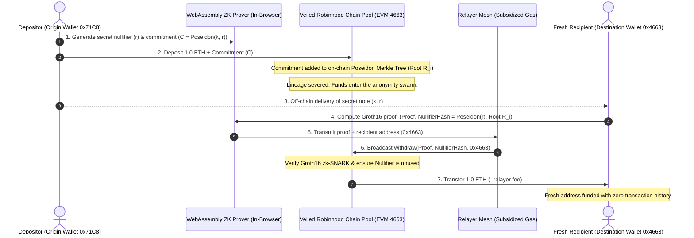

# Technical Walkthrough & Architecture: Veiled Privacy Protocol (Robinhood Chain)

> **Project**: Veiled Privacy (`$VEILED`)  
> **Target Network**: Robinhood Chain (EVM · Chain ID: `4663` · Native Asset: `ETH`)  
> **Launchpad**: Pons Family Launchpad (`https://ponsfamily.com/launchpad`)  
> **Block Explorer**: Blockscout (`https://robinhoodchain.blockscout.com`)  
> **Production Domain**: [https://veiled.space/](https://veiled.space/)  
> **Category**: EVM Zero-Knowledge Privacy, State Shielding, Fair-Launch Tokenomics  
> **Live Local URL**: [http://localhost:3000/](http://localhost:3000/)

---

## 1. Executive Summary & Design Philosophy

Veiled Privacy is an EVM-native, zero-knowledge state shield built specifically for the **Robinhood Chain ecosystem** and launching through the **Pons Family Launchpad**. 

The fundamental thesis—*untraceable state with zero lineage on EVM*—is embodied through every technical and interactive element:
* **Obsidian Negative Space**: Deep pitch-black base (`#030405`) paired with soft celestial indigo ambient halos (`#A5B4FC`).
* **The Veiled Marble Sentinel ("The Veiled Sovereign")**: Inspired by [noumen.xyz](https://www.noumen.xyz/) and Giovanni Strazza's *The Veiled Virgin*. A neo-classical stone bust completely draped in a translucent, fluid stone veil, treated with a 1-bit Bayer dither and stipple pointillism matrix. It elevates the brand from a generic "hacker hoodie" into a timeless, museum-grade philosophical monument.
* **Atmospheric Center Overlay & Fluid Physics**: The Veiled Sentinel is right-aligned on desktop (`hcx = hw * 0.72`) and enlarged up to 880px, balancing the left-aligned editorial headline with dedicated focal depth. It features an organic fluid ripple engine ($k = 0.08, \text{damping} = 0.82$) that reacts to mouse proximity like liquid silk without ever obscuring typography.
* **Justitia Velata & The Balance Scales**: Neoclassical half-figure holding balance scales at the central fulcrum in the Glass Ledger Scroll Accumulator, scaled up to 460px width, mathematically symbolizing state conservation ($\sum \text{In} = \sum \text{Out}$) in zero-knowledge pools.
* **Interactive Cryptographic Gamification**: A playable 5-node Shuffling Veil featuring **The Council of Five Veiled Sentinels** demonstrates the mathematical collapse of tracking heuristics into an impenetrable anonymity set ($5\text{ in }5$) via an authentic shroud-lift animation sequence.
* **Progressive Typography Resolution**: Words dynamically transition from optical Gaussian blur into sharp typography as the user scrolls into reading view.

---

## 2. Robinhood Chain Network Integration

Veiled Privacy integrates with the official Robinhood Chain EVM specifications:

| Parameter | Configuration | Details |
| :--- | :--- | :--- |
| **Network Name** | Robinhood Chain (Mainnet) | High-speed EVM L2 with sub-cent gas fees |
| **Chain ID** | `4663` | Standard EVM network identifier |
| **Currency Symbol** | `ETH` | Native gas token |
| **Default RPC URL** | `https://rpc.mainnet.chain.robinhood.com/` | High-throughput official RPC endpoint |
| **Block Explorer** | `robinhoodchain.blockscout.com` | Official Blockscout explorer instance |
| **Token Launchpad** | `ponsfamily.com/launchpad` | Fair-launch bonding curve with locked graduation |

---

## 3. Interactive Component & Canvas Deep Dive

### A. The Hero Veiled Sentinel Canvas (`#heroCanvas`)
The hero character is rendered on an HTML5 2D canvas with real-time vector particle dynamics:
1. **Contour & Dither Sampling**:
   * Master high-resolution 1-bit stipple artwork is loaded from `assets/veiled_sentinel.jpg`.
   * An offscreen 360x360 canvas extracts ~5,400 dither coordinates (`step = 3`, luminance threshold > 35).
   * Positioned on desktop to the right (`hcx = hw * 0.72`, `hcy = hh * 0.48`), scaled proportionally up to 880px:
     $$\text{artSize} = \min(880, w \cdot 0.54, h \cdot 0.94)$$
     This complements the left-aligned editorial typography without visual collision, with the ambient halo glow (`.halo`) tracking at `left: 72%`.
2. **Fluid Physics & Ripple Force Math**:
   * Each particle maintains home anchor coordinates $(o_x, o_y)$ and velocity $(v_x, v_y)$.
   * Ambient breathing oscillation: $y_{\text{target}} = o_y + \sin(1.3 t + \phi) \cdot 1.8\text{px}$.
   * Spring force vector pulls particles toward their anchor:
     $$\vec{F}_{\text{spring}} = 0.08 \cdot (\vec{P}_{\text{target}} - \vec{P}_{\text{current}})$$
   * Cursor proximity exerts a fluid displacement wave:
     $$\vec{F}_{\text{ripple}} = \left(1 - \frac{d}{R}\right) \cdot 6.5 \cdot \hat{u} \quad (R = 105\text{px})$$
   * Fluid damping: $\vec{v} \leftarrow \vec{v} \cdot 0.82$.
3. **Interactive Spark Reaction & Ripple Dynamics**:
   * Clicking anywhere within the hero section bursts luminous sparks toward the Veiled Sentinel, which are gravitationally drawn into the center of the veil.
   * Concurrently, an expanding shockwave ripple ($r_{\text{wave}} = t \cdot 380\text{px}$) radiates through the dither particles, illuminating the marble veil.

### B. The Scroll-Scrubbed Story Canvas (`#storyCanvas`)
The protocol workflow ("How Veiled Works") is pinned to the viewport and scrubbed by page scroll:
* **Phase Gating**:
  $$\text{target} = \text{clamp}\left(\frac{-\text{rect.top}}{\text{rect.height} - \text{stage.height}}\right)$$
* **Interpolated State ($p$) & Balance Scales Mechanics**:
  * **$p \in [0.00, 0.22]$ (Phase 01 - The Glass Ledger)**: Origin wallet A (`0x71C8…c9FE`, `14.20 ETH · EXPOSED ON-CHAIN`) with red surveillance traces. Justitia Velata's balance scale tilts down on the left pan (`tilt = -0.052 rad`) under the heavy weight of exposed funds.
  * **$p \in [0.22, 0.50]$ (Phase 02 - Sever on-Chain Lineage)**: Particles detach from sender wallet A and stream into the left pan, climbing the suspension chains into the central fulcrum. The scale levels out toward horizontal.
  * **$p \in [0.50, 0.76]$ (Phase 03 - Anonymity Swarm)**: Inside the accumulator, the scale enters harmonic equilibrium balance ($\sin(2.4t) \cdot 0.012$), surrounded by dual 3D perspective Merkle orbital rings and Poseidon hash nodes: $\sum \text{In} = \sum \text{Out}$.
  * **$p \in [0.76, 1.00]$ (Phase 04 - Clean Withdrawal)**: Unlinked funds emerge directly from the right scale pan into fresh destination wallet B (`0x4663…04AB`, `FRESH ADDRESS · NO HISTORY`) on Robinhood Chain, with the on-chain lineage severed below (`✕ NO LINK`).

### C. The Interactive 5-Node Shuffling Veil (`#game`)
Demonstrates the statistical concept of the anonymity set ($1/N$ odds) on Robinhood Chain:
* **State Machine**: `idle` $\to$ `drop` $\to$ `shuffle` $\to$ `pick` $\to$ `reveal`.
* **Nodes**: Rendered as **The Council of Five Veiled Sentinels** (`assets/veiled_bust_node.png`), classical Carrara marble busts resting on carved dark plinths.
* **Coin Rendering**: Features an **Ethereum diamond emblem** rendered directly in vector math, showcasing native 0.1 ETH deposits.
* **Full Shroud-Lift Transition Animation Sequence**:
  * **Idle**: The native `0.1 ETH` coin hovers high above the center custodian (`translateY(-210px)`) under the focused spotlight cone. The custodians rest securely on the plinths, concealing the plinth tops.
  * **Drop**: Upon clicking "Initiate Shuffle", the coin drops down (`translateY(0)`), sliding behind the custodian's veil into the plinth (`"Into the veil it goes…"`).
  * **Shuffle**: The spotlight dims during the shuffle to simulate cryptographic blinding. The 5 Veiled Custodians undergo 14 rapid randomized swaps across the floor grid with hop physics and real-time HUD swap tracking.
  * **Pick**: Hovering elevates any custodian (`translateY(-8px) scale(1.02)`) with a celestial hover aura. The chosen custodian is enveloped in a radiant golden chiaroscuro rim glow (`.picked`).
  * **Reveal**: All 5 Veiled Custodians **lift gracefully upward into the air (`translateY(-115px)`)**, ascending into the spotlight mist as the spotlight floods the entire stage (`.spot.flood`).
  * **Unveiling**: Beneath each lifted custodian, the radiant `0.1 ETH` coins pop and spin on their classical plinths, proving that every exit is mathematically indistinguishable ($5\text{ in }5$ anonymity set proof).

---

## 4. How the Privacy Protocol Model Works on EVM

---

## 5. Security & Immutability Guarantees

* **Non-Custodial**: Deposited funds are controlled strictly by cryptographic zk-SNARK verification circuits compiled to EVM bytecode.
* **No Trusted Setup Leakage**: Utilizes standard Groth16 ceremony parameters with open verification keys.
* **Front-Running Immunity**: Nullifier hashes are broadcast via relayers with recipient-bound commitments, preventing front-running MEV bots on Robinhood Chain from claiming valid proofs.
